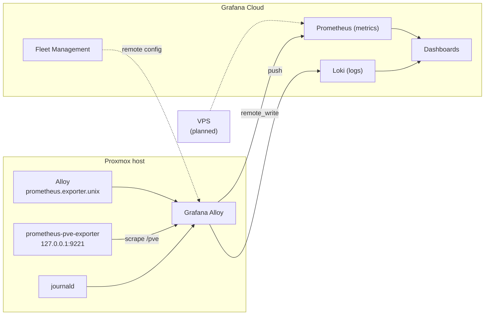

# Monitoring

Monitoring runs in **[Grafana Cloud](https://grafana.com/products/cloud/)** (free tier). Nothing heavy is self-hosted anymore —
the old stack (local Grafana, InfluxDB, Prometheus, node_exporter, Loki/Promtail) was retired.

## What is collected

| Source | How | Labels |
|---|---|---|
| Host metrics (CPU, RAM, disks, network, temps) | Alloy built-in `prometheus.exporter.unix` | `job="integrations/node_exporter"`, `instance="pve"` |
| VMs, LXCs, storages, backups status | [prometheus-pve-exporter](https://github.com/prometheus-pve/prometheus-pve-exporter) via Proxmox API (read-only `PVEAuditor` token) | `job="pve"` |
| Host logs | journald → Loki (noisy lines dropped) | `job="integrations/node_exporter"`, `instance="pve"` |
| VPS (planned) | Alloy on the VPS, same Grafana Cloud stack | — |
| Service availability | [Uptime Kuma](https://github.com/louislam/uptime-kuma) (self-hosted) | — |

New LXCs and VMs show up automatically through pve-exporter — nothing needs to be installed inside containers.

## Dashboards

- [Proxmox via Prometheus — 10347](https://grafana.com/grafana/dashboards/10347)
- [Node Exporter Full — 1860](https://grafana.com/grafana/dashboards/1860)
- Grafana Cloud "Linux Server" integration dashboards

The JSON files in [/grafana](../grafana/) are exports from the old self-hosted Grafana and are kept for reference only.

## Setup notes

- Alloy config: [scripts/alloy/config.alloy](../scripts/alloy/config.alloy). The API key comes from an environment variable, never from the config file.
- Part of the config is managed from Grafana Cloud Fleet Management (`remotecfg`), the local blocks cover host + Proxmox specifics.
- pve-exporter listens on localhost only and uses a dedicated API token with the `PVEAuditor` role.

## TODO

- Alerts in Grafana Cloud (disk usage, backup failures, host down).
