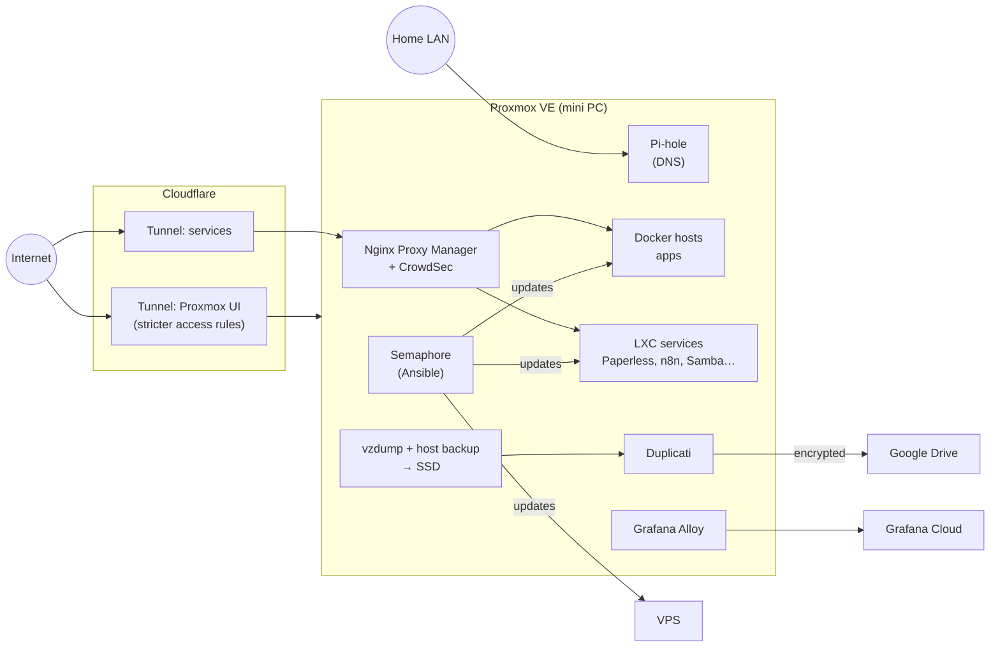
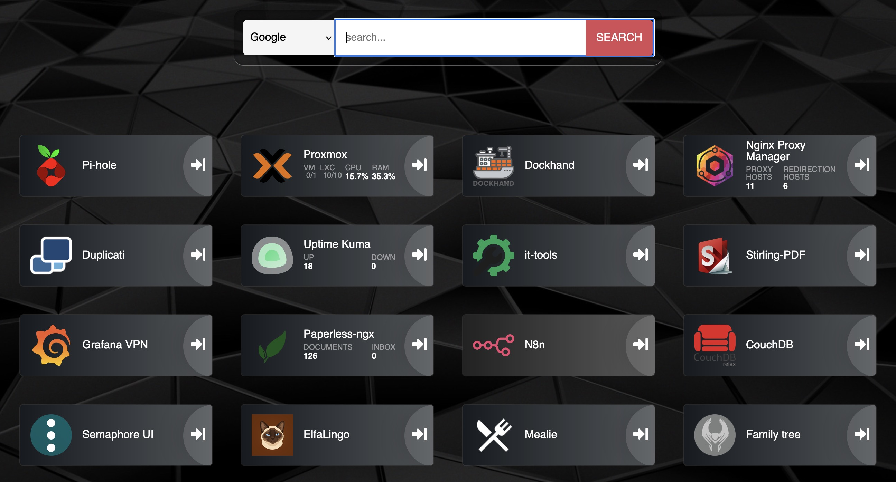

# HomeLab

My home lab: a single fanless mini PC running Proxmox VE. It started as a learning sandbox and became the main home server —
self-hosted apps, home DNS, automation, backups and a couple of my own projects.

## Hardware
| KEY | VALUE |
|--------|:-----------:|
| Model | XCY X30 |
| CPU | Intel N100 |
| Storage 1 (system) | 256GB NVMe |
| Storage 2 (data, backups) | 1TB SSD |
| RAM | 16GB |
| Net Iface | 4x 2.5GbE |

## Architecture

## What's running

All services run in LXC containers; Docker is used inside a few of them. Grouped by purpose:

**Platform & network**
- [Proxmox VE](https://www.proxmox.com/en/) — hypervisor
- [Cloudflare Tunnel](https://www.cloudflare.com/products/tunnel/) — public access without open ports
- [Nginx Proxy Manager](https://nginxproxymanager.com/) + [CrowdSec](https://www.crowdsec.net/) — reverse proxy with HTTPS and blocking of bad actors
- [Pi-hole](https://pi-hole.net/) — home DNS, ad blocking, local `*.local` names
- [Samba](https://www.samba.org/) — network file share

**Apps**
- [Paperless-ngx](https://docs.paperless-ngx.com/) — document archive
- [Mealie](https://mealie.io/) — recipes
- [Stirling PDF](https://github.com/Stirling-Tools/Stirling-PDF) — PDF tools
- [IT-Tools](https://github.com/CorentinTh/it-tools) — handy dev tools
- [Heimdall](https://github.com/linuxserver/Heimdall) — start page
- [CouchDB](https://couchdb.apache.org/) — sync backend
- **Parenthèse** — my family tree app
- **ElfaLingo** — my app for learning German

**Automation & management**
- [Semaphore](https://semaphoreui.com/) (Ansible) — scheduled OS and Pi-hole updates, see [ansible/](ansible/)
- [n8n](https://n8n.io/) — workflows and notifications (including Ansible run results)
- Dockhand + Hawser agents — Docker container management and updates

**Monitoring**
- [Grafana Cloud](https://grafana.com/products/cloud/) with [Grafana Alloy](https://grafana.com/docs/alloy/) and [pve-exporter](https://github.com/prometheus-pve/prometheus-pve-exporter) — see [Monitoring](Docs/Monitoring.md)
- [Uptime Kuma](https://github.com/louislam/uptime-kuma) — service availability

**Other**
- A Windows VM, started on demand
- An experimental HTPC container that drives the TV over the host's HDMI output
- A separate VPS (VPN), updated by the same Ansible setup

## Backups
- Proxmox backs up VMs and containers on a schedule to the data SSD; a small script also archives the host configuration itself, so the host can be rebuilt from scratch.
- [Duplicati](https://www.duplicati.com/) uploads everything, encrypted, to Google Drive.
- A few non-critical containers are deliberately excluded.

## Automation
Updates run from [Semaphore](https://semaphoreui.com/) on a schedule, playbooks live in [ansible/](ansible/):
* [Debian / Proxmox / VPN update](ansible/upd_debian.yml)
* [Pi-hole update](ansible/upd_pihole.yml)

Docker containers are updated through Dockhand. Run results are sent to n8n through a [custom webhook callback](ansible/webhook.py).

## Public access
Two separate [Cloudflare tunnels](https://www.cloudflare.com/products/tunnel/): one for services behind Nginx Proxy Manager
(HTTPS, strict allow policies, CrowdSec), and one for the Proxmox UI with stricter access rules. No ports are opened on the router.

## AI-assisted operations
The lab can be managed by an AI assistant through an MCP server with guard rails — see [AI access](Docs/AI-access.md).

## Repository layout
| Path | Content |
|---|---|
| [ansible/](ansible/) | Playbooks run by Semaphore, webhook callback plugin |
| [scripts/](scripts/) | Scripts and configs from the Proxmox host (backup, Alloy, hookscripts) |
| [Docs/](Docs/) | [New LXC checklist](Docs/How_to_set_up_new_LXC.md), [Monitoring](Docs/Monitoring.md), [AI access](Docs/AI-access.md) |
| [grafana/](grafana/) | Dashboard exports from the old self-hosted Grafana (legacy) |

## Heimdall

